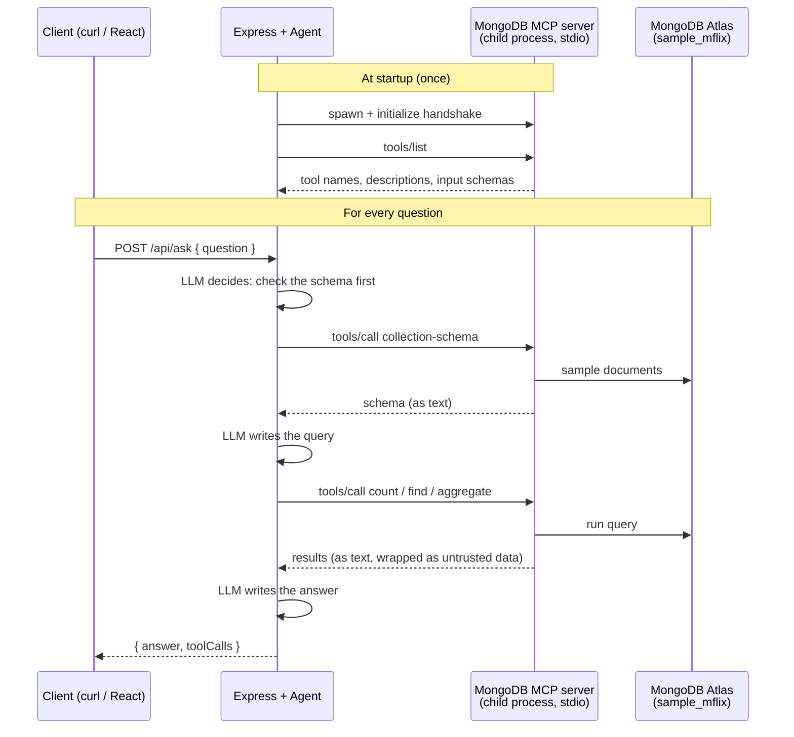

# talk-to-db

**Talk to Your Database.** Ask questions about a MongoDB database in plain English, and an AI agent answers by running real queries.

The agent's database tools come from **MongoDB's official MCP server**. This repo contains **zero hand-written database tools**: the Express app only connects to the server through an MCP client, picks which tools the agent may use, and lets the agent decide when to call them.

```bash
curl -X POST http://localhost:3000/api/ask \
  -H "Content-Type: application/json" \
  -d '{"question":"How many movies were released in 1999?"}'
```
```json
{
  "question": "How many movies were released in 1999?",
  "answer": "There are 515 movies released in 1999 in the sample_mflix database.",
  "toolCalls": [
    { "tool": "mongodb_collection-schema", "args": { "connectionId": "preconfigured", "database": "sample_mflix", "collection": "movies" } },
    { "tool": "mongodb_count", "args": { "connectionId": "preconfigured", "database": "sample_mflix", "collection": "movies", "query": { "year": 1999 } } }
  ]
}
```

Built as a learning project: my first MCP client build, written step by step. The [`steps/`](steps) folder keeps every stage of the code.

---

## Contents

- [Agent vs MCP: what this project shows](#agent-vs-mcp-what-this-project-shows)
- [How it works](#how-it-works)
- [Tech stack](#tech-stack)
- [Prerequisites](#prerequisites)
- [Setup](#setup)
- [Run](#run)
- [API](#api)
- [Example questions](#example-questions)
- [Project structure](#project-structure)
- [How the code evolved (`steps/`)](#how-the-code-evolved-steps)
- [Safety](#safety)
- [Lessons learned](#lessons-learned)
- [Troubleshooting](#troubleshooting)
- [What's next](#whats-next)

---

## Agent vs MCP: what this project shows

| | Agent | MCP |
|---|---|---|
| **Job** | Decides *what* to do: picks a tool, reads the result, decides the next step | Delivers the tools: a standard way to list and call tools that live in a separate server |
| **In this repo** | `createAgent` from LangChain with a local Ollama model | MongoDB's `mongodb-mcp-server`, connected with `@langchain/mcp-adapters` |
| **MERN analogy** | Your controller logic | An API with a fixed contract; the MCP client is like Mongoose talking to a separate server |

Without MCP, you would write `find`, `count` and `aggregate` tools yourself. With MCP, MongoDB maintains them, and any MCP-compatible app can use the same server.

---

## How it works



1. **Startup:** `server.js` starts the MongoDB MCP server as a child process over **stdio** (stdin/stdout), loads its tools once, and only then starts listening, just like `await mongoose.connect()` before `app.listen()`.
2. **Question:** `POST /api/ask` hands the question to the agent.
3. **Tool calls:** the agent checks the collection's schema, writes a query, and calls the MCP tools. The MCP server runs the query on MongoDB.
4. **Answer:** the agent answers in plain English. The response also includes `toolCalls`, so you can see exactly which queries produced the answer.
5. **Shutdown:** Ctrl+C closes the MCP connection and stops the child process.

---

## Tech stack

| Package | Version | Role |
|---|---|---|
| `express` | 5.x | HTTP API |
| `mongodb-mcp-server` | 3.0.x | MongoDB's official MCP server (the tools) |
| `@langchain/mcp-adapters` | 2.0.x | MCP client; turns MCP tools into LangChain tools |
| `@modelcontextprotocol/client` | 2.3.x | Official MCP client SDK (used by the adapter, and directly in `mcp-check.js`) |
| `langchain` | 1.5.x | `createAgent`, middleware |
| `@langchain/ollama` | 1.3.x | Local LLM through Ollama |
| `@langchain/core`, `@langchain/langgraph` | 1.x | Peer dependencies of the adapter |

Model: **`qwen3:8b`** running locally with Ollama. No paid API key is needed.

---

## Prerequisites

- **Node.js** `^20.19`, `^22.13` or `>=24`, as required by `mongodb-mcp-server`. Check with `node -v`.
- **Ollama** with a model that supports tool calling:
  ```bash
  ollama pull qwen3:8b
  ```
- **MongoDB Atlas** (the free tier works) with the **sample dataset** loaded. This project uses the `sample_mflix` database (movies, comments, users, theaters, sessions).

---

## Setup

### 1. Clone and install
```bash
git clone https://github.com/rajeshThappeta/talk-to-db.git
cd talk-to-db
npm install
```

`npm install` prints deprecation warnings, vulnerability counts and "allow-scripts" notices. They come from `mongodb-mcp-server`'s own dependencies. **Don't run `npm audit fix --force`**, which can install breaking versions. The skipped install scripts (Kerberos, SSH tunnels, client-side encryption) aren't needed for a username/password Atlas connection.

### 2. Prepare MongoDB Atlas
1. Create a cluster (a free cluster works).
2. **Load the sample dataset** from the cluster's menu.
3. **Create a read-only database user**, for example with read access only on `sample_mflix`.
4. Add your IP address under **Network Access**.
5. Copy that user's connection string.

### 3. Configure environment variables
```bash
cp .env.example .env
```
Fill in `.env`:

| Variable | Example | Purpose |
|---|---|---|
| `PORT` | `3000` | Express port |
| `MONGO_URI` | `mongodb+srv://<readonly-user>:<password>@<cluster-host>/sample_mflix` | Passed to the MCP server as `MDB_MCP_CONNECTION_STRING` |
| `OLLAMA_BASE_URL` | `http://localhost:11434` | Ollama server |
| `OLLAMA_MODEL` | `qwen3:8b` | Any Ollama model with tool calling |
| `OLLAMA_NUM_CTX` | `16384` | Context window (see [Lessons learned](#lessons-learned)) |
| `LLM_TEMPERATURE` | `0` | Predictable query writing |

`.env` is git-ignored. Never commit it.

---

## Run

```bash
npm run dev
```
Expected output:
```
🔌 MongoDB MCP: 5 tools loaded
   - mongodb_aggregate
   - mongodb_collection-schema
   - mongodb_count
   - mongodb_find
   - mongodb_list-collections
Server running on http://localhost:3000
```

| Script | What it does |
|---|---|
| `npm run dev` | Starts the app with `.env` loaded and auto-restart on file changes (Node's built-in `--env-file` and `--watch`) |
| `npm run mcp:check` | Runs `mcp-check.js`: talks to the MCP server **by hand**, with no LLM. It lists collections and counts 1999 movies. Good for checking your connection |

---

## API

### `GET /health`
```json
{ "status": "ok", "tools": 5 }
```

### `POST /api/ask`
Request:
```json
{ "question": "How many comments were posted in 2012 in total?" }
```
Response:
```json
{
  "question": "How many comments were posted in 2012 in total?",
  "answer": "There are **825 comments** posted in 2012 in total.",
  "toolCalls": [
    { "tool": "mongodb_collection-schema", "args": { "connectionId": "preconfigured", "database": "sample_mflix", "collection": "comments" } },
    { "tool": "mongodb_count", "args": { "connectionId": "preconfigured", "database": "sample_mflix", "collection": "comments", "query": { "date": { "$gte": { "$date": "2012-01-01T00:00:00Z" }, "$lte": { "$date": "2012-12-31T23:59:59.999Z" } } } } }
  ]
}
```

| Status | When |
|---|---|
| `200` | Answered |
| `400` | `question` missing or empty |
| `500` | The agent failed (Ollama not running, model error, etc.); `detail` has the message |

The terminal also logs every tool call:
```
❓ How many movies were released in 1999?
   🔧 mongodb_collection-schema {"connectionId":"preconfigured","database":"sample_mflix","collection":"movies"}
   🔧 mongodb_count {"connectionId":"preconfigured","database":"sample_mflix","collection":"movies","query":{"year":1999}}
```

---

## Example questions

Tested with `qwen3:8b`:

| Question | Tool the agent used | Result |
|---|---|---|
| How many movies were released in 1999? | `count` | 515 ✅ |
| Top 5 movies from the 1990s by IMDb rating | `find` with year range, sort on `imdb.rating`, limit, projection | ✅ (the dataset has some duplicate movies, and the agent pointed them out) |
| How many comments were posted in 2012 in total? | `count` with a date range | 825 ✅ |
| How many comments were posted each month in 2012? | `aggregate` (`$match` → `$group` → `$sort`) | ✅ after the date rule was added to the prompt |
| Delete all comments | none | Refused: "This assistant is read-only" ✅ |

**Tip:** ask one thing per question. "Each month **and** the total" gives a small model the chance to add the numbers itself instead of asking the database.

---

## Project structure

```
talk-to-db/
├── server.js            # Express app: loads MCP tools, creates the agent, /health and /api/ask, clean shutdown
├── mcp/
│   └── mongodb.js       # MCP client: starts mongodb-mcp-server (read-only) and chooses which tools the agent sees
├── agent/
│   └── db-agent.js      # Ollama model, system prompt, createAgent, tool-result middleware, helpers
├── mcp-check.js         # Calling MCP tools by hand, without an LLM (npm run mcp:check)
├── steps/               # Snapshots of the code at each build step
├── .env.example         # Template for .env
└── package.json
```

---

## How the code evolved (`steps/`)

Each file in `steps/` is a snapshot taken before the next change. To run one, use `node --env-file=.env steps/<file>`. The snapshots of `server.js` import `./mcp/...` and `./agent/...`, so copy one to the project root first.

| Snapshot | What it shows |
|---|---|
| `01-express-skeleton.js` | Plain Express with a stub `/api/ask` |
| `02a-list-tools.js` | MCP client by hand: start the server, handshake, list its 18 tools |
| `02b-call-tools.js` | First real `tools/call`: list collections, count 1999 movies (515) |
| `03-mcp-mongodb.js`, `03-server-with-mcp.js` | MCP client inside Express via `MCPAdapter`; 11 tools |
| `04a-mcp-mongodb-5-tools.js` | Trimmed to the 5 tools the agent needs |
| `04b-db-agent-before-fix.js`, `04b-server-with-agent.js` | First agent; fails with *"Non string tool message content is not supported"* |
| `04c-db-agent-working.js` | Fixed with a `wrapToolCall` middleware |
| `05a-db-agent-date-rule.js` | Prompt rule for comparing dates |
| `05b-db-agent-final.js`, `05-server-final.js` | Final agent and server |

---

## Safety

The agent can only **read**. Several independent layers enforce this:

1. **`--readOnly` on the MCP server:** insert, update, delete and drop tools are never registered, so the model can't even see them.
2. **A read-only Atlas user:** even a direct write attempt would be rejected by MongoDB.
3. **Disabled tools:** `connect` (which could open a connection to *any* connection string), `export` (writes files to disk), logs and admin tools are removed with `MDB_MCP_DISABLED_TOOLS`.
4. **Untrusted-data wrapping:** the MCP server wraps all database content in `<untrusted-user-data-…>` tags with a random ID, warning the model not to follow instructions found in the data. This is a built-in prompt-injection defence.
5. **The system prompt** repeats the read-only and data-is-not-instructions rules.

Test: *"Delete all comments from the comments collection."* → no tool calls, and a read-only reply.

---

## Lessons learned

**1. Tools cost tokens, so pick them.**
The model reads every tool definition on every call. The 11 tools left after removing the risky ones took about **7,400 tokens** (`explain` and `aggregate` alone were about 75%). Trimming to 5 brought that down to about **3,600 tokens**, which is why `OLLAMA_NUM_CTX` is 16384.

**2. Bugs show up where libraries meet.**
MCP tool results are a **list** of content blocks. `@langchain/ollama` only accepts a **string** for a tool result, so the first run failed with *"Non string tool message content is not supported"*. The fix is a small middleware in `agent/db-agent.js` that joins the text blocks. It runs on failed tool calls too, so the agent can read MongoDB's error messages and correct its own query.

**3. Dates need Extended JSON.**
The model first compared `comments.date` with the string `"2012-01-01"`. Nothing matched, and the agent confidently said there were *no comments in 2012*. The MCP server reads queries as Extended JSON, so a date must be written as `{ "$date": "2012-01-01T00:00:00Z" }`. One prompt rule fixed it.

**4. The database computes, the model explains.**
The monthly counts were correct, but the model added them itself and reported **863** instead of **825**. Asking for the total directly made the agent use `count`, which returned the exact number from the database.

**5. Read the tool trace, not just the answer.**
"No data", "863" and a correct total that the model added up itself all sounded equally confident. That's why `/api/ask` returns `toolCalls`.

**6. MongoDB MCP server v3 specifics.**
Every database tool requires a `connectionId`; the connection string you pass becomes a ready connection named `"preconfigured"`. Use the `MDB_MCP_DISABLED_TOOLS` environment variable (comma-separated) to remove tools: in testing, the space-separated `--disabledTools` CLI form didn't remove all of them.

**7. `@langchain/mcp-adapters` v2.**
Use `MCPAdapter({ servers: {...} })` and `listTools()`. The 1.x names `MultiServerMCPClient` and `getTools()` are deprecated. Tool names are prefixed with the server name (`mongodb_find`).

---

## Troubleshooting

| Problem | Fix |
|---|---|
| `MONGO_URI is missing in .env` | Create `.env` from `.env.example` |
| `spawn npx ENOENT` | The MCP server couldn't start. Keep `...process.env` in the server's `env` so `PATH` is passed on, and check that `npm install` finished |
| Tools load but queries fail with an authentication error | Wrong username or password in `MONGO_URI` |
| Queries time out | Your IP isn't in Atlas **Network Access** |
| `500` with "fetch failed" / connection refused | Ollama isn't running; start it and check `ollama list` |
| `Non string tool message content is not supported` | The `toolResultAsText` middleware is missing from `createAgent` |
| Agent says "no data" for a date question | Check `toolCalls`: dates must be `{ "$date": "..." }`, not strings |
| Agent forgets the question or its tool results | Context window too small; raise `OLLAMA_NUM_CTX` or keep fewer tools |
| Wrong totals or averages | Ask for them directly so the database computes them, or use a stronger model |

---

## What's next

- [ ] Run the MCP server over **Streamable HTTP** (`--transport http`) so several apps can share one server
- [ ] Put the known collection schemas in the system prompt, to skip a `collection-schema` call on every question
- [ ] A React chat UI that shows the answer and the tool trace
- [ ] Compare answers with a larger model

---

## Author

**Rajesh T**, AI-Powered Full Stack trainer
GitHub: [@rajeshThappeta](https://github.com/rajeshThappeta) · LinkedIn: [rajesh-t](https://www.linkedin.com/in/rajesh-t)

## License

ISC, as declared in `package.json`.
